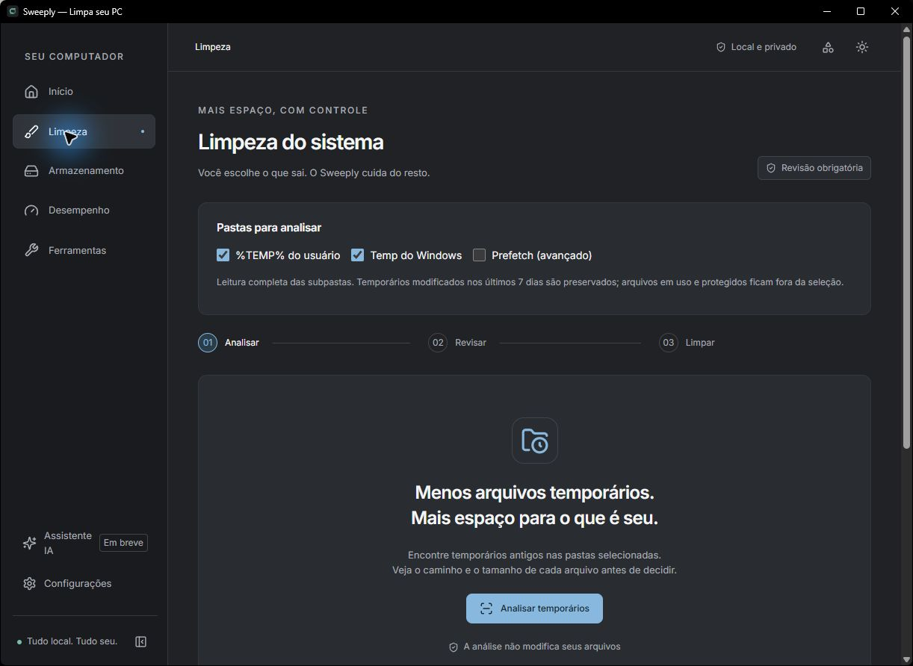
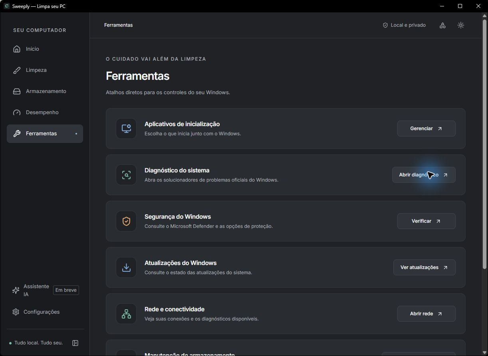
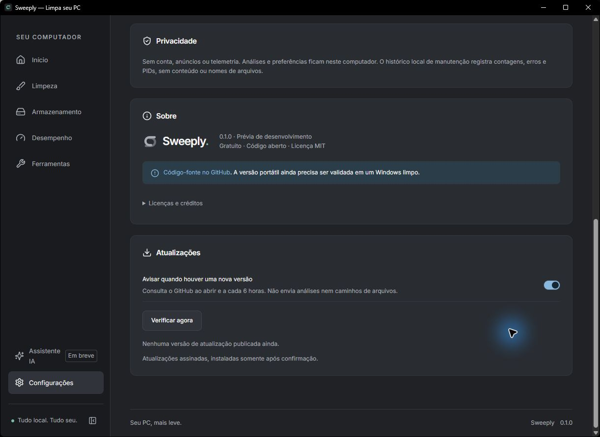

<div align="center">


# Sweeply

**Entenda seu computador. Abra espaço. Cuide do que importa.**

Um aplicativo para Windows que reúne limpeza de temporários,<br />
análise de armazenamento e acompanhamento de desempenho em um só lugar.

<br />


<br />

[Versões e downloads](https://github.com/GabriellHammes16/Sweeply/releases) · [Como executar](#executar-localmente) · [Contribuir](CONTRIBUTING.md)

<br />



<sub>Captura real do aplicativo desktop. Interface em português do Brasil.</sub>

</div>

## Seu PC, mais leve

O Sweeply ajuda a entender o que ocupa espaço e o que está em execução. Você analisa, revisa e decide. A limpeza exige seleção e confirmação; as análises funcionam localmente.

| Recurso           | O que você encontra                                                                                                             |
| ----------------- | ------------------------------------------------------------------------------------------------------------------------------- |
| **Visão geral**   | CPU, memória e armazenamento reais, atualizados a cada 2 segundos.                                                              |
| **Limpeza**       | Leitura de `%TEMP%`, Temp do Windows e Prefetch opcional, com revisão dos arquivos elegíveis. Lixeira em uma operação separada. |
| **Armazenamento** | Exploração por pastas, gráfico circular com zoom, progresso real e cancelamento, sem corte de 20 segundos.                      |
| **Desempenho**    | Busca e ordenação de processos, detalhes do executável e encerramento confirmado de processos permitidos.                       |
| **Continuidade**  | Resultados de Limpeza e Armazenamento preservados ao trocar de aba. Cache por unidade durante a sessão.                         |
| **Do seu jeito**  | Temas escuro, claro e do sistema, navegação recolhível e respeito a movimento reduzido.                                         |
| **Atualizações**  | Aviso de nova release no GitHub, botão Atualizar e instalação de pacote assinado após confirmação.                              |

## Dentro do aplicativo

### Ferramentas perto de você

Atalhos para as ferramentas oficiais de diagnóstico, segurança, rede, inicialização e armazenamento do Windows.



### Novas versões, com você no controle

A verificação vem ativada por padrão e pode ser desativada nas configurações. Quando uma release mais recente estiver publicada, o app mostra o aviso com o botão **Atualizar**. A instalação exige confirmação e verifica a assinatura do pacote.



## Baixar

Baixe o instalador **Sweeply 1.0.0** em [Releases](https://github.com/GabriellHammes16/Sweeply/releases/latest). Execute o arquivo `setup.exe` e siga as etapas de instalação.

Requisitos de uso: Windows 10/11 x64 e Microsoft Edge WebView2 Runtime. O instalador pode baixar o WebView2 se faltar. O EXE isolado ainda precisa de validação em Windows limpo; os builds não têm certificado Authenticode do Windows.

## Executar localmente

Instale Node.js 24 LTS, Rust estável MSVC, Visual Studio C++ Build Tools e Windows SDK. Consulte os [pré-requisitos do Tauri](https://v2.tauri.app/start/prerequisites/).

```powershell
npm ci
npm run tauri dev
```

Para conferir a interface no navegador, execute `npm run dev` e abra `http://127.0.0.1:1420`. As funções nativas ficam disponíveis no aplicativo desktop; a prévia web identifica essa limitação.

```powershell
# EXE de desenvolvimento com a interface incluída
npm run tauri -- build --debug --no-bundle
# Saída: src-tauri/target/debug/sweeply.exe
```

## Antes de limpar

- Temporários modificados nos últimos **7 dias**, arquivos em uso, protegidos e links são preservados. Prefetch analisa apenas `.pf` na raiz e vem desmarcado por padrão.
- Exclusões são **permanentes** e exigem revisão e confirmação. A Lixeira tem sua própria confirmação do Windows e abrange todas as unidades.
- Resultados ficam na memória durante a sessão. Fechar o aplicativo os descarta; planos de limpeza expiram após 15 minutos.
- Encerrar um processo pode perder trabalho não salvo. Processos críticos, do Windows, de outros usuários/sessões e o próprio app são protegidos.
- Pastas sem permissão são informadas. O armazenamento mostra tamanhos lógicos e agrupa itens menores no gráfico; não substitui uma auditoria do sistema de arquivos.

Sem conta, anúncios ou telemetria. O núcleo funciona offline; a consulta de atualizações acessa o GitHub. O assistente IA está identificado como **Em breve**, sem conexão com provedores nesta versão.

## Desenvolvimento

```powershell
npm run lint
npm test
npm run build
cargo fmt --manifest-path src-tauri/Cargo.toml -- --check
cargo test --locked --lib --manifest-path src-tauri/Cargo.toml
cargo clippy --locked --manifest-path src-tauri/Cargo.toml -- -D warnings
npm run release:check
```

O workflow de release gera instaladores NSIS e o manifesto do atualizador a partir de tags `v*`, usando a chave de assinatura guardada em secret do GitHub. A release começa em rascunho para revisão. Veja [como publicar uma versão](docs/releases.md).

| Documentação                              | Conteúdo                                                  |
| ----------------------------------------- | --------------------------------------------------------- |
| [Operação e segurança](docs/operation.md) | Pastas analisadas, critérios de limpeza e limites de uso. |
| [Arquitetura](docs/architecture.md)       | Backend Rust, contratos IPC e validações.                 |
| [Design system](docs/design-system.md)    | Identidade, componentes, temas e acessibilidade.          |
| [Contribuição](CONTRIBUTING.md)           | Orientações para alterações e testes.                     |

## Licença

Código original sob [MIT](LICENSE). Inter e Lucide mantêm suas respectivas licenças, listadas em [créditos de terceiros](THIRD_PARTY_NOTICES.md).

<div align="center">

<br />

**Sweeply · Seu PC, mais leve.**

</div>
